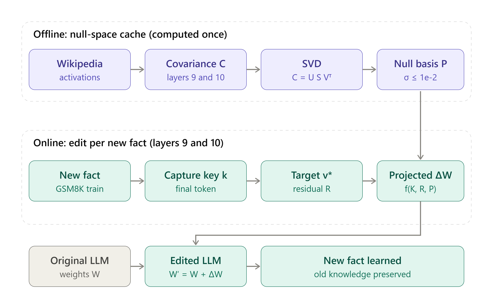

# Knowledge-Self-Editing-LLM
A lightweight toolkit to easily and quickly edit Large Language Model (LLM) knowledge without full retraining. Implements core knowledge self-editing algorithms and pre-computed null-space caching for seamless updates.

## Knowledge self-editing pipeline



This figure summarizes the overall flow of this project. The method is an
AlphaEdit-style knowledge-editing technique that we are introducing as a
starting point for further experimentation and optimization.

### Offline stage: build the null-space cache

The offline stage is computed once before editing:

1. Wikipedia activations are collected for the selected decoder layers, currently
   layers 9 and 10.
2. The activations are used to form a covariance matrix \(C\).
3. Singular value decomposition produces \(C = U S V^T\).
4. The right singular vectors whose singular values satisfy
   \(\sigma \leq 10^{-2}\) are selected as the approximate null basis \(P\).
5. The basis is cached on disk. `main.py` only loads the cache; it does not
   recompute the Wikipedia activations or SVD during each edit.

### Online stage: edit one new fact at a time

For each new fact, the online stage performs the following steps:

1. A key \(k\) is captured from the final token of the fact's prompt.
2. Target optimization finds a desired activation \(v^*\), producing a residual
   \(R\) between the current and desired target.
3. A projected solve uses \(K\), \(R\), and \(P\) to calculate a weight update
   \(\Delta W\).
4. The edited model is formed as:

   \[
   W' = W + \Delta W
   \]

Because the update is projected into the approximate null space of the
preservation covariance, it is intended to change the requested behavior while
minimizing disruption to outputs associated with previously preserved
knowledge. In practical terms, the goal is to learn the new fact while keeping
old knowledge as stable as possible.

### Current research direction

This implementation is an experimental starting point rather than a finished
production system or an exact reproduction of the reference paper. The
reference research reports a capacity of roughly 3,000 new facts for this type
of editing setup; that limit should be treated as a research claim to validate
for this implementation, not as a guarantee. We will use this project to
measure edit success, locality, and knowledge retention, then improve the
algorithm based on research findings and experimental results.

## Folder structure

```text
Knowledge-Self-Editing-LLM/
│
├── config/
│   └── models.json
│
├── utils/
│   ├── __init__.py
│   ├── singular_value_decomposition.py
│   ├── cache_manager.py
│   ├── model_loader.py
│   ├── target_optimization.py
│   ├── activation_capture.py
│   └── alphaedit_update.py
│
├── cache/
│   └── gemma-4-E2B/
│       ├── layer_9/
│       │   ├── covariance.pt
│       │   ├── covariance_mean.pt
│       │   └── null_basis_mean.pt
│       │
│       └── layer_10/
│           ├── covariance.pt
│           ├── covariance_mean.pt
│           └── null_basis_mean.pt
│
├── results/
│
├── calculate_null_space_cache.py
├── main.py
└── README.md
```

Your existing covariance data should remain at:
`cache/gemma-4-E2B/layer_9/` and `cache/gemma-4-E2B/layer_10/`.

## Install

In the same environment as the model:
```bash
pip3 install -U torch transformers datasets accelerate sentencepiece
```
Gemma-4 requires a Transformers release that exposes `AutoModelForMultimodalLM`.

## 1. Prepare the null-space cache

```bash
python3 calculate_null_space_cache.py --model gemma-4-E2B
```

This calls `utils/singular_value_decomposition.py` through `utils/cache_manager.py`.
It reads `covariance_mean.pt`, or derives it from the existing `covariance.pt`
sum by dividing by 100000. It never downloads Wikipedia or recomputes activations.

SVD convention:
- covariance C = U S V^T
- singular vectors with singular values <= threshold are selected
- the approximate null basis is V[:, selected]

Default threshold is absolute `1e-2`. Use `--relative-threshold` only if you
intend threshold * largest singular value.

## 2. Run the editing main file

```bash
CUDA_VISIBLE_DEVICES=0 python3 main.py --model gemma-4-E2B --num-edits 2
```

After a successful pilot:
```bash
CUDA_VISIBLE_DEVICES=0 python3 main.py --model gemma-4-E2B --num-edits 10
```

The main file only loads `null_basis_mean.pt`. If any required basis is missing,
it prints the missing paths and exits. It never calculates a null space.

## 3. Select another configured model

List model keys in `config/models.json`. For example:
```bash
CUDA_VISIBLE_DEVICES=0 python3 main.py --model gemma-4-E4B --num-edits 2
```

The E2B entry is the configured reference setup. Other entries are templates
and are marked `validated: false`; verify model architecture, decoder path,
layer count, dimensions, edit layers, and prepare a matching covariance cache
before using them. Do not reuse E2B's 6144-dimensional null basis for another model.

To add a model, add a new object under `models` in `config/models.json` and set
`default_model` or pass `--model <key>`.

## Research caveats

This is an experimental AlphaEdit-style implementation, not exact paper
reproduction. It uses mean-pooled Wikipedia activation covariance, GSM8K
question-final-token keys, and simplified target optimization without the full
KL-preservation prompt set.

Use GSM8K train for edits and test only for evaluation. Keep baseline and
post-edit prompt, decoding, and answer extraction identical.

The projected solve uses CPU float32 matrices to reduce GPU memory pressure,
but 6144x6144 operations still require substantial RAM and may be slow.
Some dispatched models may have selected weights on the `meta` device due to
offloading; direct in-place edits require the selected weights to be materialized.
